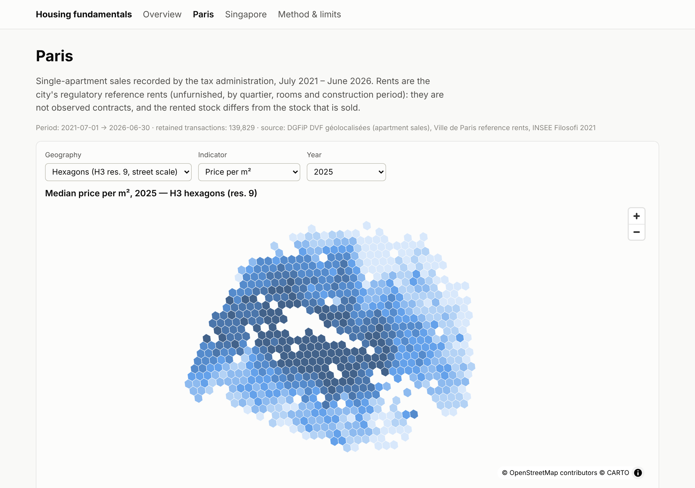
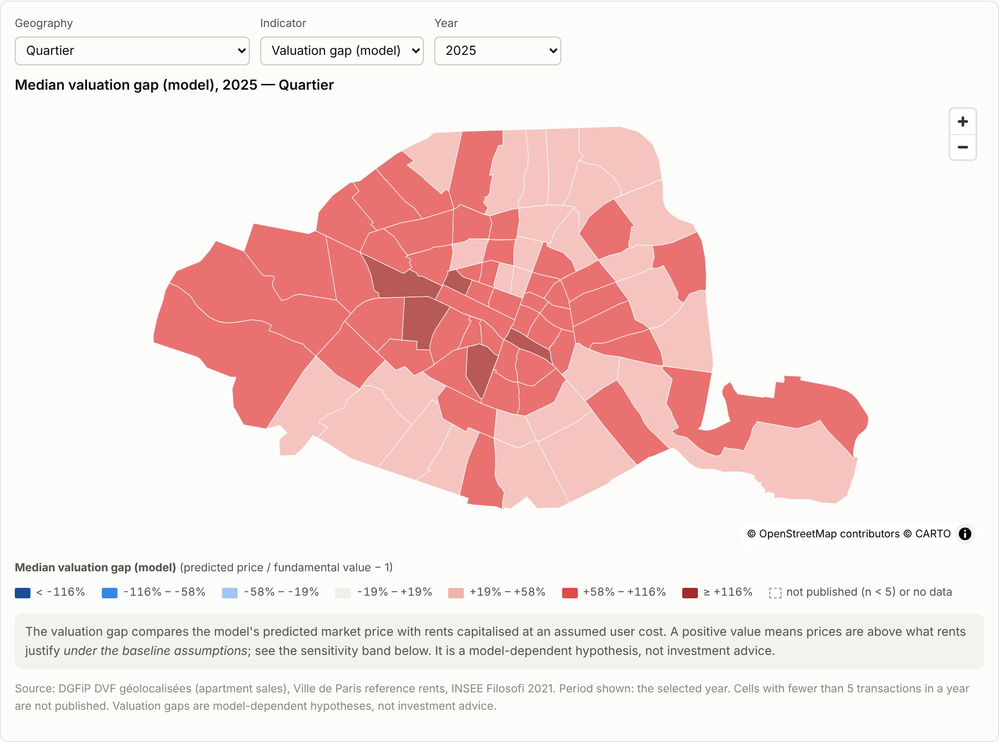
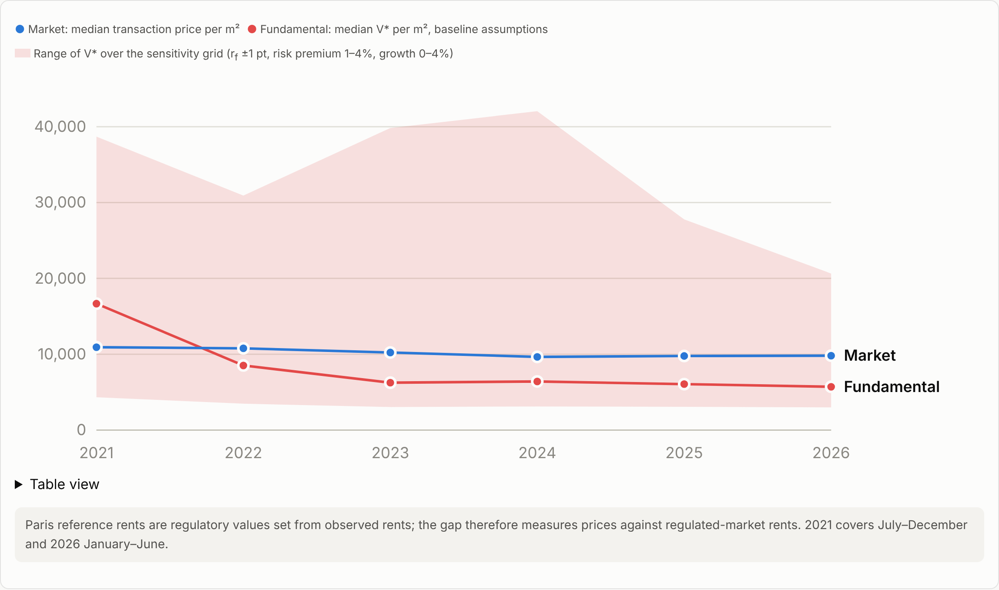
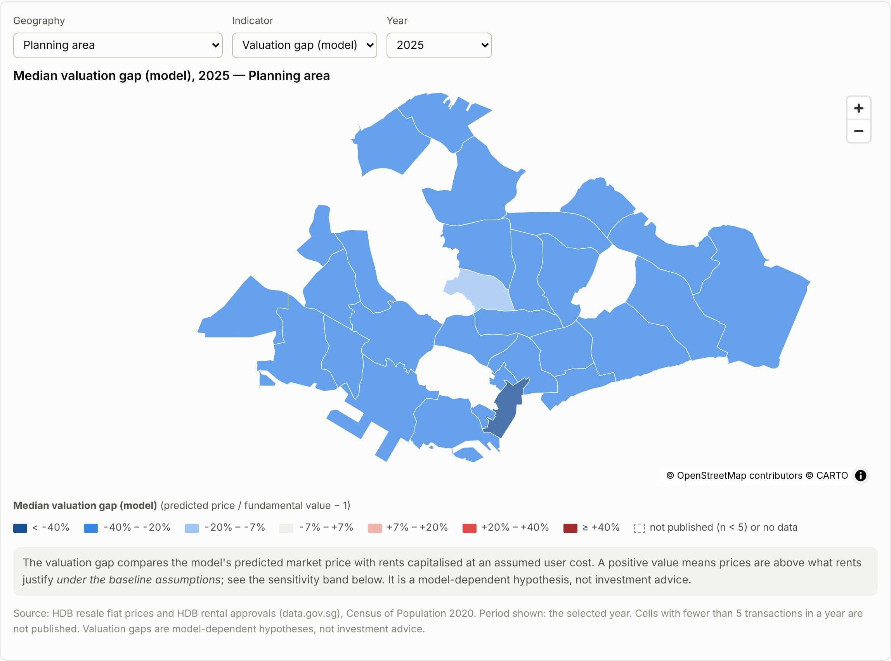
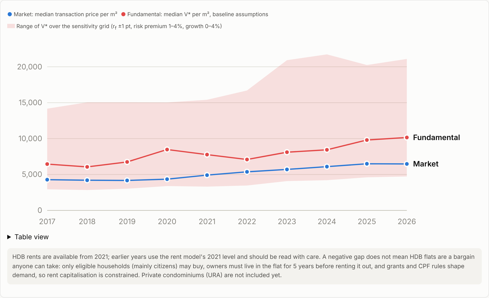

# Are Housing Prices Justified by Fundamentals?

*A machine-learning and rent-capitalisation approach to residential valuation — Paris and Singapore.*

> **Status: work in progress.** Paris, Singapore HDB and Singapore private (URA) are built.
> Robust cell statistics (bootstrap CI, shrinkage), quality-adjusted price indices checked
> against the official ones, explosive-root tests and a verdict table are computed for the
> three markets (`data/processed/robust_*`, `index_*`, `explosive_*`, `verdict.csv`); they
> are not on the website yet. Open: a longer Paris history, data-licence checks (URA) and
> the Kaggle dataset.

Hedonic and ML models trained on transaction prices estimate **market** value. They cannot
tell whether market value is justified. This project anchors **fundamental** value on rents
capitalised at the user cost of housing (Poterba 1984; Himmelberg, Mayer & Sinai 2005) and
tests overvaluation as a **hypothesis**, under explicit and varied assumptions. Because rents are a
constrained expense, a second pillar tracks **market tension and liquidity** (turnover, volume
versus price, unsold supply, rent-to-income): a market can look "justified" by rents while it is
stuck, with volumes falling far faster than prices.

- [Website (GitHub Pages)](https://jojolap1.github.io/housing-fundamentals-thesis/paris.html): maps by street-scale hexagon, district and neighbourhood; a
  fundamental-vs-market chart with a sensitivity band; a street table.
- Kaggle (planned): the processed, aggregated dataset and a notebook that reproduces the main tables
  and maps (`notebooks/reproduce_main_results.ipynb`).







## Data

Only official registers are used; no single source covers both cities at address level.
See [`docs/data_audit.md`](docs/data_audit.md) for licences, coverage, row counts and biases.

| City | Prices | Rents | Income |
|---|---|---|---|
| Paris | DGFiP DVF géolocalisées, apartment sales Jul 2021 – Jun 2026 | Ville de Paris reference rents 2019–2025 (regulatory values) | INSEE Filosofi 2021, IRIS |
| Singapore (HDB) | HDB resale flat prices, Jan 2017 – latest month | HDB "Renting out of flats", 2021 – latest month | Census of Population 2020, planning area |
| Singapore (private) | URA private transactions, Nov 2021 – latest month (needs a URA access key) | URA rental contracts, 2022 – latest quarter | Census of Population 2020, planning area |

Every downloaded file is recorded in `data/raw/MANIFEST.csv` (URL, time, size, SHA-256).
Raw files and transaction-level intermediates are **not** in the repository.

## Reproduce

```bash
pip install -r requirements.txt
```

```bash
make data      # download all sources into data/raw (about 1 GB transferred, ~1-2 h with geocoding)
```

```bash
make indices   # robust statistics (bootstrap CI, shrinkage) and price indices
```

```bash
make models    # clean, harmonise, features, ratios, models, valuation
```

```bash
make verdict   # explosive-root tests, price-to-rent dynamics, verdict table
```

```bash
make site      # site/data/*.json and site/*.html
```

```bash
make test
```

Without a local copy of the raw data, the workflow `Rebuild data (public sources)`
(`.github/workflows/build-data.yml`) downloads the public sources on a GitHub runner, rebuilds
the aggregates and commits only those; raw and transaction-level files stay on the runner.

Seeds are fixed in `src/config.py`; package versions are written to
`data/processed/package_versions.json`.

## Layout

```
data/raw/         downloads (git-ignored) + MANIFEST.csv
data/interim/     transaction-level files (git-ignored: addresses, parcel ids)
data/processed/   published aggregates (n >= 5 per cell), cleaning logs, model tables
src/ingest/       download scripts (DVF, Paris open data, IGN, IDFM, data.gov.sg, OneMap, ECB, SingStat)
src/clean/        harmonised schema, cleaning rules, removal log
src/features/     distances, building period, matched rents
src/ratios/       price/rent/yield/price-to-income by level; user cost, V*, valuation gap, sensitivity;
                  robust statistics (mean, trimmed mean, bootstrap CI, shrunk medians)
src/indices/      hedonic time-dummy, stratified-median and repeat-sales price indices; volume index
src/valuation/    SADF/GSADF explosive-root tests, price-to-rent dynamics, verdict rule
src/models/       OLS (district FE, robust SEs, Moran's I), Random Forest, LightGBM, SHAP
src/viz/          site data export and page generation
site/             static site (MapLibre GL), deployed by .github/workflows/pages.yml
docs/             data_audit.md, methodology.md (with references), limitations.md
notebooks/        Kaggle notebook
tests/            schema, sanity and privacy checks
```

## Privacy and reuse terms

- DVF reuse terms: no re-identification and no search-engine indexing. Only aggregates with
  n ≥ 5 transactions per cell-year are published, never single transactions or addresses,
  and every page carries `noindex`.
- Derived databases built on ODbL sources (Paris reference rents, quartiers, green spaces)
  are released under **ODbL**. Code is under the MIT licence (see `LICENSE`).

## Read with care

Valuation gaps depend on assumed risk premium, expected growth, tax and maintenance (see the
sensitivity grid). They are model-dependent hypotheses, not investment advice. The relative
mispricing layer (model residuals) means cheap or expensive versus comparable dwellings, not
a bubble. See [`docs/limitations.md`](docs/limitations.md).
